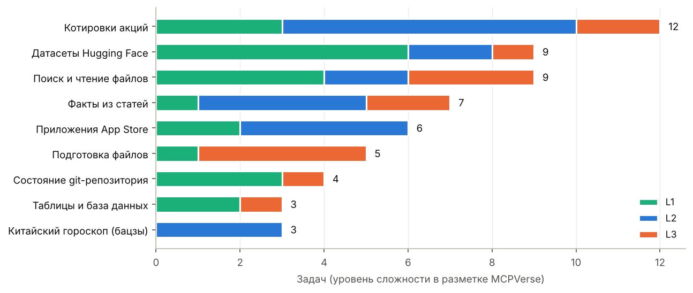
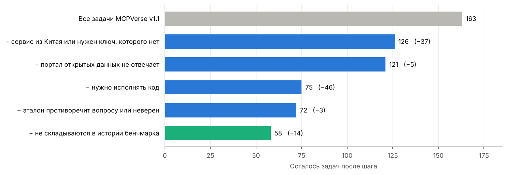
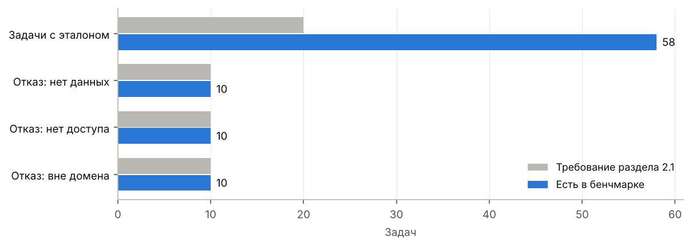
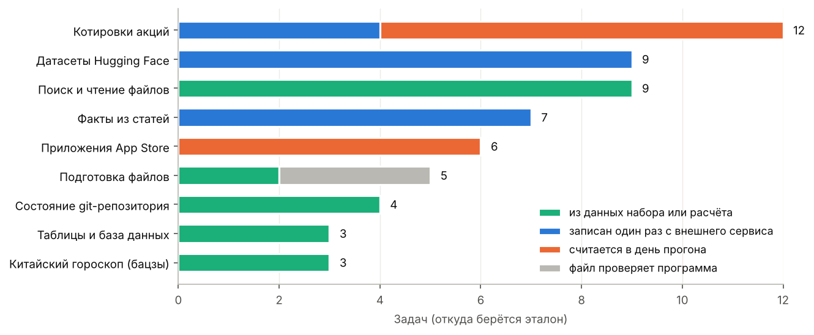
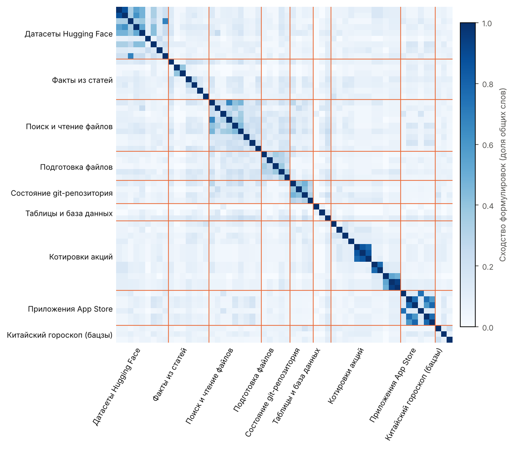

# EDA задач бенчмарка

Бенчмарк из раздела 2.1 [дизайн-документа](../ml_system_design_doc.md) собран из [MCPVerse](https://arxiv.org/abs/2508.16260), открытого набора задач для ассистентов с подключёнными сервисами.

Задача бенчмарка состоит из вопроса, нужных сервисов, эталона и способа проверки. История это группа задач, которые решает один навык. На бенчмарке сравниваем три конфигурации ассистента, без навыков, с навыками бейзлайна и с навыками бейзлайна после доработки SkillFactory. Прогон это решение одной задачи в одной конфигурации.

## Состав

В MCPVerse 163 задачи на английском. Мы перевели все вопросы на русский и проверили, что числа и пути к файлам в переводе не изменились. Отобрали 58 задач в девяти историях.

Задачи MCPVerse устроены так же, как рабочие запросы сотрудника. Ассистент ищет данные через сервисы и действует по шагам из навыка, поэтому бенчмарк показывает, помогает ли навык в таких задачах.

Истории разного размера, от 3 до 12 задач, и одна история о котировках акций даёт пятую часть бенчмарка. Рядом со средним по задачам показываем разницу конфигураций по каждой истории, иначе результат определит одна эта история. Одна задача из 58 меняет точность на 1,7 процентного пункта.

Уровень сложности ставили авторы набора, от L1 (один вызов сервиса) до L3 (длинная цепочка вызовов). Среди всех 163 задач на L3 приходится треть, среди отобранных четверть, потому что исключённые задачи чаще были сложными. Результат на нашем бенчмарке не переносится на MCPVerse целиком.

## Объём

У каждой исключённой задачи одна причина. 37 задач требуют сервисов из Китая или ключей доступа, которых у нас нет. 5 задач идут через портал открытых данных, который не отвечает. 46 задач требуют исполнять код, а наш ассистент этого не умеет. У 3 задач эталон неверен, они разобраны в разделе о качестве. Из последних 14 задач шесть складываются в две истории о Википедии и веб-страницах для настройки промптов. Задачи о времени не используем из-за ошибок в эталонах, а пять одиночных задач в истории не складываются.

Задач с эталоном хватает, но ни один эталон не ожидает отказа. Поэтому мы сделали из настоящих задач 30 задач отказа, по 10 на каждую категорию из раздела 2.1. В задаче "нет данных" объекта из вопроса не существует, а в задаче "нет доступа" сотрудник с заданной ролью просит данные, на которые у этой роли нет прав. Для "вне домена" взяли исключённые задачи на сервисы, которых у ассистента нет. Правильный ответ везде известен заранее.

## Качество

Пустых полей в наборе нет, кроме эталона у 37 задач, где он по замыслу вычисляется в день прогона. Эталоны ставили авторы набора под свои цели, и мы проверяем их сами. 14 эталонов мы пересчитали по данным набора, все совпали. В трёх из них ответ зависит от того, учитывать ли вложенные папки. Эталон их не учитывает, и перед прогонами мы уточним это в вопросе. Три эталона не отвечают на вопрос. Например, на вопрос о торгах в выходные дни августа эталон отвечает про апрель. Эти задачи мы исключили.

От происхождения эталона зависит, может ли он устареть. 21 эталон получается из данных набора или расчётом и не меняется. 20 эталонов записаны один раз по ответу внешнего сервиса и могут разойтись с его новыми данными. 14 эталонов, все в котировках и приложениях App Store, вычисляются в день прогона. В 3 задачах ассистент создаёт файл, и его проверяет программа. Задачу прогоняем сразу после расчёта эталона, а записанные эталоны сверяем с сервисом.

Сходство вопросов считали как долю общих слов. 19 пар совпадают наполовину и больше, и все они внутри одной истории, а между историями сходство не выше 0,28. Обычно это один вопрос с другим кодом акции, приложением или датой. Если объединить такие пары, остаётся 44 разных вопроса из 58. Поэтому задачи одной истории не разносим между настройкой и тестом, а разброс результата оцениваем по историям.

13 из 41 текстового эталона короче 30 символов, это число, имя файла или короткая фраза. Судья это языковая модель, которая сравнивает ответ с эталоном. Короткие ответы проверяем без него, и они служат метками для его проверки. Остальные эталоны это абзацы и таблицы, на них судью проверяем по ручной разметке.

Задачи взяты из зафиксированной версии [репозитория MCPVerse](https://github.com/hailsham/mcpverse) с лицензией Apache 2.0, повторный расчёт даёт те же числа и графики.
