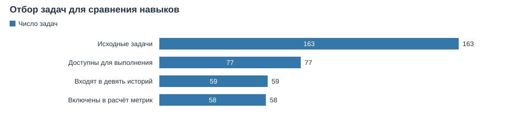
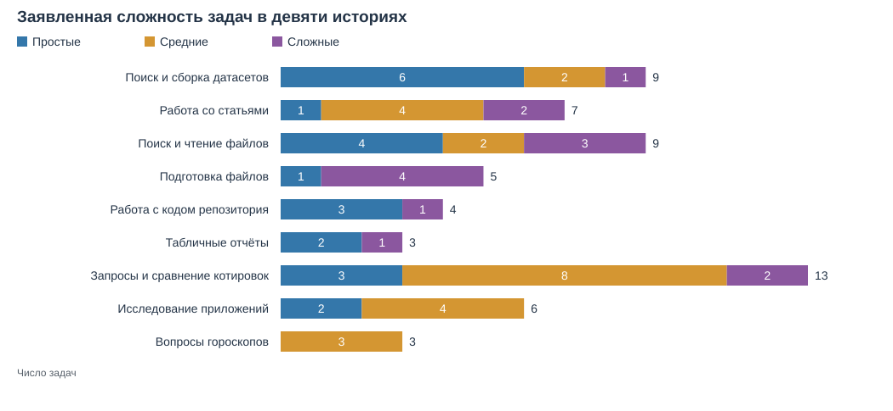
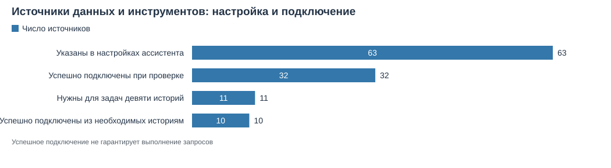
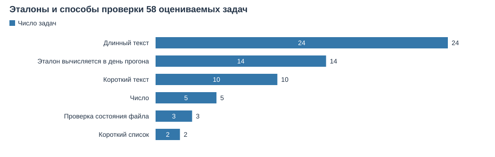
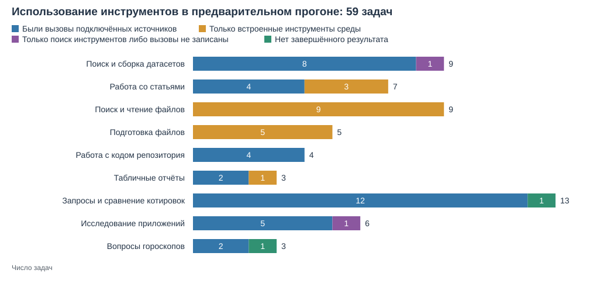
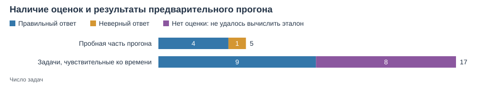

# Исследовательский анализ MCPVerse v1.1

Сравниваем два способа создавать навыки для ассистента. Бейзлайн это генератор навыка за один вызов модели, SkillFactory это агент, который дорабатывает навык через диалог с методологом и проверки ассистента. Анализ проверяет, подходит ли для такого сравнения бенчмарк MCPVerse, публичный набор задач ассистента с инструментами MCP.

## Отбор задач

Исходный бенчмарк содержит 163 задачи. У 126 эталонный ответ записан в тексте, у 37 он привязан ко времени и вычисляется в день прогона. Каждая задача задаёт вопрос, нужные серверы, названия инструментов, сложность и способ проверки.

Правила отбора оставляют 77 запускаемых задач. Сорок шесть задач просят исполнить код и не описывают бизнес-процесс сотрудника. Тридцать четыре опираются на сервисы, недоступные в нашем регионе, это карты, железнодорожные билеты, авиарейсы и реестр компаний. Пять задач на сервере открытых данных datagov отброшены, потому что их источник отвечает ошибкой на каждый вызов. Одна задача на сервере investor отброшена, потому что сервер не удалось запустить.

Из 77 запускаемых задач 59 входят в девять историй. История объединяет задачи одного повторяющегося процесса, под неё готовим один навык. Вне историй остаются 18 задач. Семнадцать из них одиночные, по одной-три задачи на нишевый сервер без повторяющегося процесса и общей роли сотрудника, группы под один навык они не образуют. Восемнадцатая это Q121, исключённая из-за дефекта эталона. Из 59 задач историй оцениваем 58. Q200 оставляем в истории, но исключаем из расчёта метрик.

## Дефекты эталонов

Реестр дефектов хранит три записи, и у каждой своё место в воронке.

Q200 спрашивает котировки за 9 и 10 августа 2025 года. Это суббота и воскресенье, торгов в эти дни не было. Эталон при этом записан за апрель. Задача остаётся в истории котировок, но из оценки исключена. Проверка дат в вопросах всех финансовых задач не нашла других выходных или чужих месяцев.

Q121 содержит эталонный часовой столп (элемент ответа китайской астрологической карты), который не соответствует указанному времени рождения. Задачу вывели из истории целиком, в ней остаются три задачи.

У Q162 эталонное изображение из открытого астрономического архива "картинка дня" не соответствует дате вопроса. Задача не входила в истории и относится к задачам вне них.

Все три дефекта найдены при проверке эталонов, два последних при ручной сверке эталонов с правилами астрологических карт и архивом "картинок дня".

## Истории и сложность

Истории охватывают запросы котировок, поиск и сборку датасетов, чтение и подготовку файлов, работу со статьями, заявки в приложениях, задачи по коду репозитория, вопросы гороскопов и табличные отчёты. В истории котировок 13 задач, из которых оцениваются 12. В историях датасетов и чтения файлов по девять. В истории статей семь, в истории приложений шесть, в подготовке файлов пять. В истории репозитория четыре задачи, в истории гороскопов и в табличной истории по три.

Задачи внутри истории похожи. Проверка по словесной близости нашла 18 пар с заметным пересечением формулировок. Это сходство по словам, а не доказательство дублей по смыслу. Поэтому задачи одной истории держим вместе при расчёте интервала разницы, случайное разбиение по задачам дало бы слишком похожие примеры в наборах для разработки и контроля.

В 59 покрытых задачах заявленная сложность распределяется как 22 задачи простого уровня L1, 23 среднего уровня L2 и 14 сложного уровня L3. В оцениваемых 58 задачах это 22, 22 и 14. Метки описывают заявленную сложность, а не измеренную длину трассы.

Чувствительных ко времени задач 14. Восемь относятся к истории котировок, шесть к исследованию приложений. Ошибка одного вычислителя эталонов может затронуть заметную долю выборки и почти всю отдельную историю.

## Окружение и выбор инструментов

В конфиге ассистента перечислены 63 сервера. Проверка подключения подняла 32 из них. Для всех исходных задач нужны 26 серверов без учёта исполнения кода. Девяти историям нужны 11 серверов, проверка подключила десять.

Подключение не равно работоспособности. Сервер корейских котировок помечен в проверке как упавший, хотя в трассах, записях вызовов инструментов, предварительного прогона он отвечал. Сервер рыночных данных alphavantage тоже значится отказавшим, но вызывался в восьми финансовых задачах. Серверы datagov и variflight, наоборот, подключаются, но не отвечают на вызовы. Перед экспериментом проверяем сервер реальным вызовом, а не статусом подключения.

У подключённых серверов проверка учла 307 инструментов, на серверы историй приходятся 136 из них. У поискового сервера список инструментов отсутствует вовсе, поэтому 307 это неполное число учтённых инструментов. В аннотациях задач историй встречаются 43 уникальных имени инструментов.

В конфиге ассистента стоит общее разрешение на все действия. Он не доказывает режим только MCP. Стенд итогового сравнения фиксируется отдельным решением и проверяется вызовами запрещённых инструментов на стенде.

## Эталоны и качество проверки

В 58 оцениваемых задачах 55 проверяет LLM-судья и три проверяются файловой проверкой. Судья сравнивает ответ с эталоном по смыслу, а не по совпадению строк. Дословное сравнение штрафовало бы перефразирование и принимало бы правдоподобный текст с неверными деталями, поэтому такой упрощённый способ мы не используем.

По формату эталоны делятся на 24 длинных текста, 14 вычисляемых, десять коротких текстов, пять чисел, два коротких списка и три файловые проверки. Это разметка по формату ответа, а не экспертная оценка трудности.

Две файловые истории содержат 14 задач на чтение и запись файлов, но файловую проверку имеют только три из них. У Q172 и Q176 судья оценивает текст ответа, хотя задача требует записи. Сохраняем фактическое состояние файлов после каждого запуска для разбора таких расхождений. В протоколе итогового сравнения (раздел 3.3 дизайн-документа) состояние файла входит в оценку запуска и через неё в вердикт задачи, поэтому разбиение 55 и 3 относится к исходной разметке.

В самих таблицах дублей строк и идентификаторов нет. У десяти задач в вопросах смешаны типы кавычек, у Q60 лишняя закрывающая скобка. Это дефекты формулировок, которые нужно исправить при переводе на русский.

## Что показывает предварительный прогон

Предварительный прогон проходил на английском языке со встроенными инструментами среды, то есть со штатными поиском и исполнением кода в обход MCP. Его режим отличается от всех трёх конфигураций итогового сравнения, он нужен только для диагностики стенда.

Из 59 покрытых задач завершены 57. У Q224, вопроса совместимости двух людей по датам рождения, и Q226, вопроса о максимумах цен двух акций, завершённого результата нет. Из 57 завершённых в 37 ассистент вызывал MCP, в 18 использовал только встроенные инструменты, в одной выполнил только поиск инструментов, ещё в одной вызовы не записаны. Все 14 задач двух файловых историй обошлись без MCP. Такое поведение меняет предмет эксперимента, поэтому итоговые прогоны идут в режиме только MCP.

В 12 задачах ассистент вызвал серверы за пределами аннотации задачи. В восьми финансовых он взял сервер alphavantage вместо аннотированного yahoo-finance, в четырёх статьёвых arxiv вместо аннотированного поискового сервера. Это подтверждённые расхождения выбора сервера. На них проверим, помогает ли навык выбрать нужный сервер и повысить долю правильных ответов. Само по себе расхождение ещё не доказывает неверный ответ.

У Q253, где надо сравнить число отзывов двух приложений, записанных вызовов нет вовсе, а оценка сохранена как правильная. У Q150, вопроса о том, какой из двух датасетов поддерживает предпросмотр, есть только поиск инструментов. По отсутствию вызовов нельзя доказать ответ из памяти, для этого нужны полная трасса и текст ответа.

На 57 завершённых задачах историй половина заняла не больше 25,5 секунды, 90% не больше 88,9 секунды. Медиана входных токенов, единиц объёма текста, 16993. Эти значения получены на другом стенде и помогают предварительно оценить расход времени и токенов. Затраты итогового сравнения измеряем отдельно.

Предварительные оценки нельзя склеить в одну долю правильных ответов. Пробная часть прогона дала четыре правильных ответа и один неверный. У чувствительных ко времени задач записано девять правильных ответов и восемь отсутствующих оценок. Все восемь пустых относятся к истории котировок и вызваны ошибкой вычисления эталона в день прогона. Задачу без вычисленного эталона не оцениваем. Перед экспериментом нужно восстановить вычислители или признать, что протокол эксперимента на этих задачах не выполнен.

## Достаточность данных

58 оцениваемых задач достаточно для первого парного сравнения и разбора ошибок по историям. Этого мало для уверенного вывода о произвольных бизнес-процессах. Одна задача меняет долю примерно на 1,7 процентного пункта (п.п.), для порога 15 п.п. нужны минимум девять исправленных задач без потерь при исправлении всех трёх повторов. На крупнейшую историю приходится около 21% оцениваемых задач, поэтому интервал строим бутстрепом историй, а не отдельных задач.

Одного точечного порога мало, потому что один и тот же прирост может складываться из разных пар улучшений и потерь. Окончательное решение принимаем по заранее заданному интервалу разницы и точечному приросту, а не по одному значению теста.

Пополнение бенчмарка должно добавлять новые истории с новыми процессами, а не варианты известных вопросов. После первого корректного парного прогона оценим разброс эффектов между историями и число разногласий, по ним посчитаем нужный объём следующего сбора.

## Конфиденциальность и границы анализа

Вопросы истории гороскопов содержат даты и время рождения, принадлежность реальным людям неизвестна. Конфиги хранят локальные пути и ссылки на переменные с ключами. Трассы могут содержать ответы внешних серверов. Публикуем только агрегаты и идентификаторы задач. Перед передачей снимка другой команде нужна отдельная проверка конфиденциальности и работа на синтетических данных.

В данных нет русских формулировок, вычислителей эталонов, файловых проверок и тестовых данных. Их готовность и качество перевода анализ не подтверждает. Сохранённые эталоны Q306 и Q307, дат прошлых воскресенья и понедельника, согласуются с датой вычисления, заявленный в описании бенчмарка дефект дней недели не подтверждается.

Анализ выявил три дефекта эталонов, обход MCP на предварительном стенде, расхождение проверки подключения с реальной доступностью и 12 задач с расхождением выбора сервера. Для эксперимента сначала нужны русские вопросы, рабочие вычислители эталонов и проверенный запрет встроенных инструментов. Только после этого сравниваем навыки бейзлайна с теми же навыками после доработки SkillFactory.
