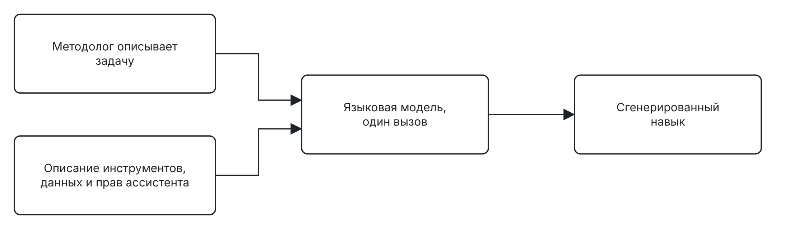
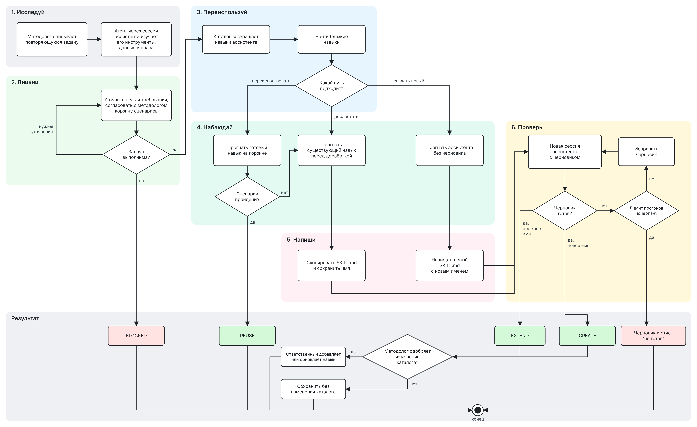

# SkillFactory – генерация агентных навыков на основе описания бизнес-задач

Документ построен по [шаблону Reliable ML](https://github.com/IrinaGoloshchapova/ml_system_design_doc_ru/blob/main/ML_System_Design_Doc_Template.md).

## 1. Цели и предпосылки

### 1.1. Зачем разрабатывать продукт

Сотрудники компании задают вопросы агенту-ассистенту, например "сколько человек в моём подразделении не прошли обязательное обучение". К ассистенту подключают базы данных, внутренние API и другие сервисы, но исполнять код во время разговора он не может. Повторяющиеся задачи он решает по навыкам. Навык – файл `SKILL.md` с инструкцией для класса задач. В нём написано, какие инструменты и данные брать, с какими параметрами и фильтрами и когда отказывать. Без подходящего навыка ассистент чаще выбирает не тот инструмент, поле или фильтр или отказывает без причины.

Сейчас навык пишет разработчик по описанию методолога, владельца бизнес-процесса. Методолог знает процесс, но не знает, какие инструменты, данные и права доступа есть у ассистента, и не умеет писать инструкции для модели. Навык проходит три-четыре круга правок за одну-две недели, это около дня работы разработчика, и часть ошибок находят уже пользователи. Альтернатива ручной работе – навык за один вызов языковой модели, но модель не видит реальных ответов инструментов и не может спросить, какое из двух похожих полей статуса нужно методологу.

**Цель – методолог сам получает проверенный навык для своей повторяющейся задачи, а сотрудники реже получают от ассистента неверные ответы и необоснованные отказы.** SkillFactory – агент, который по описанию задачи создаёт навык и проверяет его прогонами ассистента.

Карту эффекта строим по цепочке от проблемы к деньгам.

| Звено | Что происходит |
| --- | --- |
| Проблема | Навык пишет разработчик за несколько кругов правок, часть ошибок находят сотрудники |
| Решение | SkillFactory создаёт и проверяет навык по описанию методолога |
| Действие | Методолог проходит одну сессию с агентом, разработчик подключается, только если черновик "не готов" |
| Эффект | Разработчик тратит на навык меньше часов, навык готов за одну сессию вместо одной-двух недель, ассистент правильно решает больше задач |
| Деньги | Часы разработчика на других задачах и часы, которые сотрудники не тратят на перепроверку ответов, за вычетом стоимости прогонов агента |

Эффект считаем от лучшей альтернативы, сейчас это ручной навык разработчика. Часы разработчика станут деньгами, только если их займут другой работой. Юнит расчёта – задача сотрудника, которую ассистент решил правильно, а не вызов модели.

**Успех итерации** – навыки SkillFactory точнее существующих и бейзлайна без потери корректных отказов.

### 1.2. Бизнес-требования и ограничения

#### Сценарий использования

Методолог своими словами описывает повторяющуюся задачу. SkillFactory запускает сессии ассистента и выясняет, какие инструменты, данные и права у него есть. Затем агент задаёт методологу вопросы и показывает корзину сценариев – запросов сотрудников с ожидаемым результатом для этого навыка. Методолог подтверждает корзину или правит её.

Дальше агент ищет близкий навык в каталоге, прогоняет ассистента и завершает сессию одним из исходов из раздела 2.1. После EXTEND или CREATE методолог решает, менять ли каталог. Получив BLOCKED, методолог запрашивает недостающие данные или доступ, а черновик "не готов" передаёт разработчику. Прочитать и поправить готовый навык он может, но не обязан.

#### Требования

| Требование | Обоснование |
| --- | --- |
| Выявлять и уточнять бизнес-цель и требования, согласовывать с методологом понимание задачи и корзину | Цель знает методолог, агент не выдумывает её за него |
| Узнавать инструменты, данные и права у самого ассистента, подключать нового ассистента через адаптер без правок агента | Методолог окружения не знает, а у разных ассистентов оно разное |
| По умолчанию применять в навыке только фильтры, которые требует методолог | Фильтр, который агент выбрал сам, может отрезать нужные строки |
| Искать готовый навык до создания нового | Дубли мешают ассистенту выбирать навык |
| Доработка не отвечает хуже исходного навыка ни на одном сценарии | Исходным навыком уже пользуются сотрудники |
| Отдавать только ту версию навыка, которая прошла последний прогон | Правка после прогона может сломать проверенное |
| Выдавать BLOCKED с объяснением, если задачу решить нельзя | Методолог узнаёт причину до того, как сотрудники получат отказы |
| Менять каталог только с согласия методолога | Каталог общий для всех сотрудников |

#### Ограничения

- Создание навыка укладывается в одну рабочую сессию методолога, ориентир – два часа вместе с ответами на вопросы агента.
- Число прогонов ассистента за сессию ограничено до её начала.
- Создание навыка не расширяет права ассистента. Навык использует только то, что ассистенту уже доступно.
- Агент и ассистент работают на открытой языковой модели, которую компания разворачивает у себя.

#### Что ожидаем от итерации

В этой итерации делаем всё из раздела 1.3 и проводим пилот. Денежный эффект в этой итерации не измеряем. Проверяем долю правильно решённых задач, от которой он зависит, и после пилота переводим её в деньги по цепочке из раздела 1.1.

#### Критерии успеха пилота

Пилот идёт на тестовом стенде на пяти-шести классах задач бенчмарка, где навыка нет или в его ответах сотрудники находили ошибки, по одной сессии на класс. Сессии проходят методологи этих классов, кейсов бенчмарка они не видят. Полученные навыки сравниваем на бенчмарке из раздела 2.1. По трассам считаем прогоны и токены агента. Сессию дольше двух часов или с исходом "не готов" считаем сессией без нового навыка. Метрики делим на целевую, защитные и диагностическую.

| Метрика | Роль | Как считаем | Порог |
| --- | --- | --- | --- |
| Answer accuracy | целевая | Доля правильно решённых задач на кейсах классов пилота, среднее трёх прогонов. Конфигурации сравниваем попарно, бутстреп ведём по классам задач, потому что кейсы одного класса проверяют один навык. Ошибка формата даёт 0, задачу с инфраструктурной ошибкой исключаем из всех конфигураций | Выше конфигурации с существующими навыками на 15 п.п. и выше бейзлайна. На кейсах чужих классов не ниже, чем с существующими навыками, с допуском в один кейс |
| Correct refusal | защитная | Доля задач отказа, где ассистент отказал по верной причине. Отказ по доступу засчитываем, только если ассистент отказал до обращения к данным | Не ниже 0,9, и ни в одной категории отказа не больше одного потерянного кейса. Потерянный кейс – задача, где с существующими навыками ассистент верно отказывал в большинстве прогонов, а с новыми нет |
| Время и токены ассистента | защитная | Длительность решения и токены на задачах, которые обе конфигурации решили правильно | Медиана не больше чем на 20% выше, чем с существующими навыками |
| Загрузка навыка | диагностическая | Доля запусков, где ассистент загрузил новый навык, отдельно на кейсах своего и чужих классов | Без порога |

Часы разработчика окупают сессии уже при равной точности с ручным навыком. Порог 15 п.п. над существующими навыками – прирост, при котором, по нашей оценке, сотрудники станут заметно реже перепроверять ответы. Этот порог экономический, его задаём до пилота. Навык, который учит ассистента чаще отвечать, может поднять точность на задачах с эталоном и уронить Correct refusal на задачах отказа. Разросшуюся инструкцию видно по времени и токенам.

Прирост засчитываем, если точечная оценка попарной разницы не ниже порога, а нижняя граница её 90% бутстреп-интервала выше нуля. Если агент по этому правилу не обгоняет бейзлайн, а бейзлайн сам проходит пороги над существующими навыками, берём бейзлайн, он проще и дешевле. Если прирост над существующими навыками меньше 15 п.п., но навыки не хуже их и защитные метрики в норме, навыки создаёт методолог через SkillFactory, а сотрудники пока перепроверяют ответы. Если навыки хуже существующих или нарушена защитная метрика, не масштабируем, разбираем трассы, а навыки пока пишет разработчик. При успехе подключаем другие классы задач и других ассистентов, а перед добавлением навыка в каталог прогоняем бенчмарк с ним и без него.

#### Риски

Каждый риск описываем цепочкой "причина – риск – эффект". Вероятность и последствия оцениваем по 10-балльной шкале, важность равна их произведению.

| Причина | Риск | Эффект | В × П | Что делаем |
| --- | --- | --- | --- | --- |
| Корзину сценариев агент составляет по описанию методолога | Корзина плохо описывает реальные запросы сотрудников к этому навыку | Навык проходит корзину и ошибается в работе | 6 × 8 = 48 | Mitigate. На этапе "Вникни" методолог подтверждает или правит корзину до написания навыка. В пилоте расхождение с реальными запросами покажет бенчмарк |
| В данных есть похожие поля, на малой корзине они дают одинаковый результат | Агент сам делает одно из полей фильтром по умолчанию, и доработка теряет кейсы, которые решал исходный навык | Сотрудники получают ошибки на запросах, которые раньше решались | 6 × 8 = 48 | Mitigate. Сравниваем черновик с исходным навыком на корзине с такими формулировками |
| Ассистент сам выбирает навык из каталога | Новый навык перехватывает запросы, которые правильно решал другой навык | Падает точность на других классах задач | 4 × 8 = 32 | Mitigate на бенчмарке, где точность и загрузку считаем на кейсах чужих классов. В сессии перехват не виден |
| Ассистент отвечает по-разному на один и тот же запрос | Один прогон даёт случайный результат | Агент признаёт черновик готовым из-за случайно удачного ответа, а сравнение на бенчмарке получается неустойчивым | 6 × 5 = 30 | Accept в сессии, потому что повтор сценариев израсходовал бы лимит прогонов. Mitigate на бенчмарке тремя прогонами каждой конфигурации |
| Ассистент находит навык по названию и описанию | Ассистент не загружает черновик, и прогон ничего не говорит о навыке | Агент правит содержание, хотя дело в описании | 4 × 6 = 24 | Mitigate. Агент видит в трассе, загружен ли черновик, и при незагрузке правит название и описание. На бенчмарке риск виден по метрике загрузки |

### 1.3. Что входит в проект, что не входит

#### Входит

- Агент SkillFactory с шестью этапами и исходами REUSE, EXTEND, CREATE, BLOCKED и "не готов".
- Адаптер для подключения ассистента. Он отдаёт каталог навыков и запускает изолированные сессии ассистента с черновиком и без него. В итерации подключаем одного ассистента, адаптер рассчитан на любого.
- Бейзлайн для сравнения.
- Сравнение на бенчмарке в трёх конфигурациях ассистента с сохранением трасс.

#### Не входит

- Фронтенд и бэкенд приложения. Их делает другая команда.
- Автоматическая публикация в каталог.
- Обучение и дообучение моделей. Агент и ассистент обращаются по API к готовым открытым моделям, которые компания развернула у себя.

#### Качество кода и воспроизводимость

Каждый прогон можно повторить. Для этого мы фиксируем снимок данных, отпечаток каталога, версию модели и трассу сессии. Код проходит ruff и pre-commit в CI.

#### Технический долг

Лимит прогонов и длительность сессии уточним по трассам пилота.

### 1.4. Предпосылки решения

| Предпосылка | Следствие для решения |
| --- | --- |
| Ассистент не исполняет код во время разговора | Навык – текстовая инструкция для модели, а не программа |
| Система хранения принимает навык одним файлом | Выход агента – один `SKILL.md` |
| Один навык покрывает один класс повторяющихся задач | На каждый класс – одна сессия SkillFactory |
| Методолог не знает инструментов, данных и прав ассистента и не обязан читать навык | Окружение агент узнаёт через сессии ассистента, а готовность черновика определяют прогоны на корзине |
| Ассистент сам находит навык в каталоге | Черновик подключаем к изолированной сессии как дополнительный навык и не вставляем его текст в запрос |
| Права в подключённых системах меняются и бывают настроены с ошибками | Правильный отказ по доступу – только до обращения к данным |
| Похожие поля на небольшой выборке часто совпадают | В корзину входят формулировки, на которых такие поля дают разный результат |

## 2. Методология

### 2.1. Постановка задачи

**Вход.** Описание задачи от методолога и его ответы на вопросы агента по ходу сессии.

**Выход.** Один из исходов. REUSE указывает на готовый навык. EXTEND и CREATE дают проверенный `SKILL.md`. BLOCKED содержит объяснение. При исчерпанном лимите исход – Черновик и отчёт "не готов".

**Критерий готовности.** Черновик готов, если все сценарии корзины дают ожидаемый ответ и ни один не хуже точки сравнения. Точка сравнения – ответы существующего навыка перед доработкой или ассистента без черновика перед созданием нового.

| Компонент | Задача |
| --- | --- |
| Цикл агента | Одна языковая модель выбирает следующее действие внутри текущего этапа |
| Код этапов | Задаёт порядок этапов, лимит прогонов, критерий готовности, подтверждение корзины и решение методолога об изменении каталога |
| Диалог с методологом | Задать вопрос, показать корзину сценариев, получить подтверждение или правку |
| Адаптер ассистента | Вернуть каталог навыков, запустить изолированную сессию ассистента с черновиком или без него, вернуть ответ и трассу |

**Почему агент, а не фиксированный конвейер.** Прогоны ассистента можно встроить и в фиксированный конвейер, который генерирует навык, прогоняет заданные сценарии и исправляет навык по ошибкам. Но методолог не знает окружения ассистента, и следующий шаг зависит от того, что нашлось по ходу работы. Например, если в данных есть два похожих поля статуса, агент спрашивает методолога, какое нужно, и проверяет ответ прогоном. Конвейер задаёт шаги заранее, а агент выбирает их сам в пределах лимита прогонов.

Ограничения надёжнее держать в архитектуре и правах, чем в промпте, поэтому инструмента, который меняет каталог, у агента нет. Это одна модель в цикле с инструментами, без мультиагентной системы.

**Бейзлайн.** Языковая модель за один вызов получает описание задачи и описание инструментов, данных и прав ассистента и возвращает навык. Агентность обосновываем сравнением с ним и с существующими навыками, которые написал разработчик. Слабый бейзлайн завышает прирост сложного решения, поэтому промпт бейзлайна доводим так же тщательно, как промпты агента.

**Бенчмарк.** Не меньше 60 бизнес-задач, из них не меньше 20 с эталонными ответами и не меньше 10 на каждую категорию отказа – нет данных, нет доступа, нет навыка, задача вне домена. Конфигураций ассистента три – без навыков, с существующими навыками, с существующими навыками и новым. Третью собираем отдельно для навыков агента и бейзлайна, в каждую добавляем сразу все навыки пилота и прогоняем на всём бенчмарке. Навык бейзлайна заменяет существующий навык своего класса. Если сессия не дала нового навыка, класс остаётся с существующим навыком или без навыка. В классы пилота входят не меньше 30 кейсов бенчмарка. Задачи категории "нет навыка" берём из классов вне пилота. Кейсы бенчмарка не входят в корзину.

### 2.2. Схемы решения

#### Бейзлайн

Модель не запускает ассистента, не задаёт вопросов, не смотрит в каталог, и исхода BLOCKED у неё нет.

#### SkillFactory

1. **Исследуй.** Агент через сессии ассистента изучает его инструменты, данные и права.
2. **Вникни.** Агент уточняет цель и требования и согласует с методологом корзину. Невыполнимая задача даёт BLOCKED, неясная – ещё круг вопросов.
3. **Переиспользуй.** Агент находит в каталоге близкие навыки и выбирает путь – переиспользовать, доработать или создать новый.
4. **Наблюдай.** Прогон на корзине подтверждает готовый навык и даёт REUSE, иначе агент переходит к доработке. Для доработки и нового навыка прогон фиксирует точку сравнения.
5. **Напиши.** Агент дорабатывает копию существующего навыка под прежним именем или пишет новый.
6. **Проверь.** Агент прогоняет черновик в новой сессии и исправляет его, при спорном ожидании сначала уточняет его у методолога. Цикл идёт, пока черновик не готов и лимит не исчерпан. Итог – EXTEND, CREATE или Черновик и отчёт "не готов".

После EXTEND или CREATE методолог решает, менять ли каталог. При согласии ответственный за каталог добавляет или обновляет навык, иначе результат остаётся без изменения каталога.
