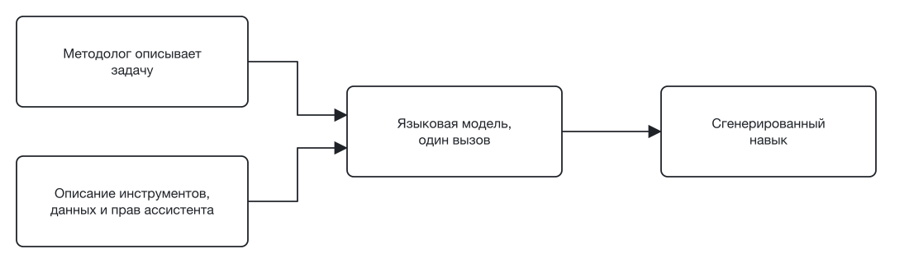
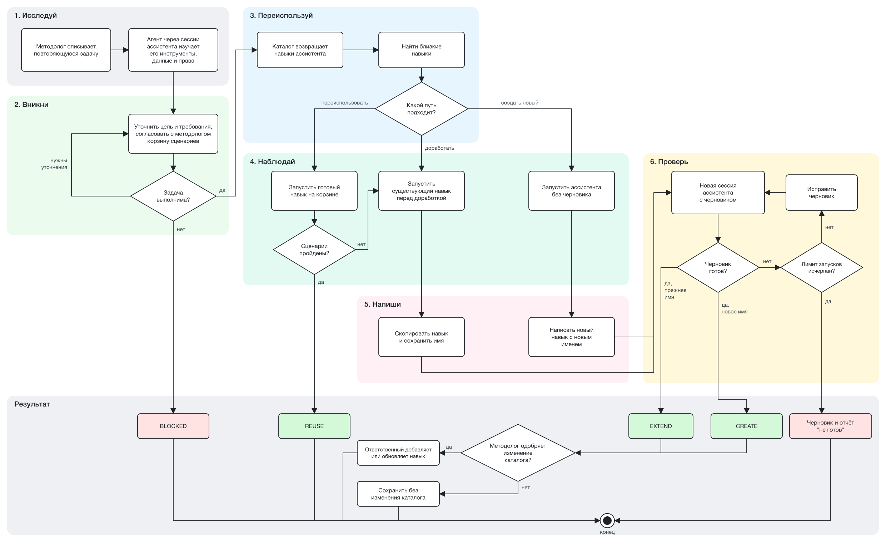

# SkillFactory – генерация агентных навыков на основе описания бизнес-задач

Документ построен по [шаблону Reliable ML](https://github.com/IrinaGoloshchapova/ml_system_design_doc_ru/blob/main/ML_System_Design_Doc_Template.md).

## 1. Цели и предпосылки

### 1.1. Зачем разрабатывать продукт

Сотрудники компании задают вопросы ассистенту, например "сколько человек в моём подразделении не прошли обязательное обучение". К ассистенту подключают базы данных, внутренние API и другие сервисы, но исполнять код во время разговора он не может. Повторяющиеся задачи он решает по навыкам. Навык – файл `SKILL.md` с инструкцией для класса задач. В нём написано, какие инструменты и данные брать, с какими параметрами и фильтрами и когда отказывать. Без подходящего навыка ассистент чаще выбирает не тот инструмент, поле или фильтр или отказывает без причины.

Сейчас навык пишет разработчик по описанию методолога, владельца бизнес-процесса. Методолог знает процесс, но не знает, какие инструменты, данные и права доступа есть у ассистента, и не умеет писать инструкции для модели. Навык проходит три-четыре круга правок за одну-две недели, это около дня работы разработчика, и часть ошибок находят уже сотрудники. Альтернатива ручной работе – навык за один вызов языковой модели, но модель не видит реальных ответов инструментов и не может спросить, какое из двух похожих полей статуса нужно методологу.

**Цель – методолог сам получает проверенный навык для своей повторяющейся задачи, а сотрудники реже получают от ассистента неверные ответы и необоснованные отказы.** SkillFactory – агент, который по описанию задачи создаёт навык и проверяет его запусками ассистента.

Карту эффекта строим по цепочке от проблемы к деньгам.

| Звено | Что происходит |
| --- | --- |
| Проблема | Навык пишет разработчик за несколько кругов правок, часть ошибок находят сотрудники |
| Решение | SkillFactory создаёт и проверяет навык по описанию методолога |
| Действие | Методолог проходит одну сессию с агентом, разработчик подключается, только если черновик "не готов" |
| Эффект | Разработчик тратит на навык меньше часов, навык готов за одну сессию вместо одной-двух недель, ассистент правильно решает больше задач |
| Деньги | Часы разработчика на других задачах и часы, которые сотрудники не тратят на перепроверку ответов, за вычетом стоимости запусков агента |

Эффект считаем от лучшей альтернативы, сейчас это ручной навык разработчика. Часы разработчика станут деньгами, только если их займут другой работой. Единица расчёта – задача сотрудника, которую ассистент решил правильно, а не вызов модели.

**Успех итерации** – навыки SkillFactory точнее навыков бейзлайна без потери правильных отказов.

### 1.2. Бизнес-требования и ограничения

#### Сценарий использования

Методолог своими словами описывает повторяющуюся задачу. SkillFactory запускает сессии ассистента и выясняет, какие инструменты, данные и права у него есть. Затем агент задаёт методологу вопросы и показывает корзину сценариев – запросов сотрудников с ожидаемым результатом для этого навыка. Методолог подтверждает корзину или правит её.

Дальше агент ищет близкий навык в каталоге, запускает ассистента и завершает сессию одним из исходов из раздела 2.1. После EXTEND или CREATE методолог решает, менять ли каталог. Получив BLOCKED, методолог запрашивает недостающие данные или доступ, а черновик "не готов" передаёт разработчику. Прочитать и поправить готовый навык он может, но не обязан.

#### Требования

| Требование | Обоснование |
| --- | --- |
| Выявлять и уточнять бизнес-цель и требования, согласовывать с методологом понимание задачи и корзину | Цель знает методолог, агент не выдумывает её за него |
| Узнавать инструменты, данные и права у самого ассистента, подключать нового ассистента через адаптер без правок агента | Методолог окружения не знает, а у разных ассистентов оно разное |
| По умолчанию применять в навыке только фильтры, которые требует методолог | Фильтр, который агент выбрал сам, может отрезать нужные строки |
| Искать готовый навык до создания нового | Дубли мешают ассистенту выбирать навык |
| Доработка не отвечает хуже исходного навыка ни на одном сценарии | Исходным навыком уже пользуются сотрудники |
| Отдавать только ту версию навыка, которая прошла последний запуск | Правка после запуска может сломать проверенное |
| Выдавать BLOCKED с объяснением, если задачу решить нельзя | Методолог узнаёт причину до того, как сотрудники получат отказы |
| Менять каталог только с согласия методолога | Каталог общий для всех сотрудников |

#### Ограничения

- Создание навыка укладывается в одну рабочую сессию методолога, ориентир – два часа вместе с ответами на вопросы агента.
- Число запусков ассистента за сессию ограничено до её начала.
- Создание навыка не расширяет права ассистента. Навык использует только то, что ассистенту уже доступно.
- Агент и ассистент работают на открытой языковой модели, которую компания разворачивает у себя.

#### Что ожидаем от итерации

В этой итерации делаем всё из раздела 1.3 и проводим пилот. Денежный эффект в этой итерации не измеряем. Проверяем долю правильно решённых задач, от которой он зависит, и после пилота переводим её в деньги по цепочке из раздела 1.1.

#### Критерии успеха пилота

Пилот идёт на тестовом стенде на девяти историях задач бенчмарка, где навыка нет или в его ответах сотрудники находили ошибки, по одной сессии на историю. Сессии проходят методологи этих историй, задач бенчмарка они не видят. Полученные навыки сравниваем на бенчмарке из раздела 2.1. По трассам считаем запуски и токены агента. Сессию дольше двух часов или с исходом "не готов" считаем сессией без нового навыка. Метрики делим на целевую, защитные и диагностическую.

| Метрика | Роль | Как считаем | Порог |
| --- | --- | --- | --- |
| Answer accuracy | целевая | Доля правильно решённых задач на задачах историй пилота, среднее трёх повторов. Конфигурации сравниваем попарно, бутстреп ведём по историям задач, потому что задачи одной истории проверяют один навык. Ошибка формата даёт 0, задачу с инфраструктурной ошибкой исключаем из всех конфигураций | Выше конфигурации с навыками бейзлайна на 15 п.п. На задачах чужих историй не ниже, чем с навыками бейзлайна, с допуском в одну задачу |
| Correct refusal | защитная | Доля задач отказа, где ассистент отказал по верной причине. Отказ по доступу засчитываем, только если ассистент отказал до обращения к данным | Не ниже 0,9, и ни в одной категории отказа не больше одного потерянного задачаа. Потерянной считается задача, где с навыками бейзлайна ассистент верно отказывал в большинстве повторов, а с новыми нет |
| Время и токены ассистента | защитная | Длительность решения и токены на задачах, которые обе конфигурации решили правильно | Медиана не больше чем на 20% выше, чем с навыками бейзлайна |
| Применение навыка | диагностическая | Доля запусков, где ассистент применил новый навык, отдельно на задачах своих и чужих историй | Без порога |

Часы разработчика окупают сессии уже при равной точности с бейзлайном. Порог 15 п.п. над навыками бейзлайна – прирост, при котором, по нашей оценке, сотрудники станут заметно реже перепроверять ответы. Этот порог экономический, его задаём до пилота. Навык, который учит ассистента чаще отвечать, может поднять точность на задачах с эталоном и уронить Correct refusal на задачах отказа. Разросшуюся инструкцию видно по времени и токенам.

Прирост засчитываем, если точечная оценка попарной разницы не ниже порога, а нижняя граница её 90% бутстреп-интервала выше нуля. Если агент по этому правилу не обгоняет бейзлайн, а бейзлайн сам проходит пороги над конфигурацией без навыков, берём бейзлайн, он проще и дешевле. Если прирост над навыками бейзлайна меньше 15 п.п., но навыки не хуже бейзлайна и защитные метрики в норме, навыки создаёт методолог через SkillFactory, а сотрудники пока перепроверяют ответы. Если навыки хуже бейзлайна или нарушена защитная метрика, не масштабируем, разбираем трассы, а навыки пока пишет разработчик. При успехе подключаем другие истории задач и других ассистентов, а перед добавлением навыка в каталог запускаем бенчмарк с ним и без него.

#### Риски

Каждый риск описываем цепочкой "причина – риск – эффект". Вероятность и последствия оцениваем по 10-балльной шкале, важность равна их произведению.

| Причина | Риск | Эффект | В × П | Что делаем |
| --- | --- | --- | --- | --- |
| Корзину сценариев агент составляет по описанию методолога | Корзина плохо описывает реальные запросы сотрудников к этому навыку | Навык проходит корзину и ошибается в работе | 6 × 8 = 48 | Mitigate. На шаге "Вникни" методолог подтверждает или правит корзину до написания навыка. В пилоте расхождение с реальными запросами покажет бенчмарк |
| В данных есть похожие поля, на малой корзине они дают одинаковый результат | Агент сам делает одно из полей фильтром по умолчанию, и доработка теряет задачи, которые решал исходный навык | Сотрудники получают ошибки на запросах, которые раньше решались | 6 × 8 = 48 | Mitigate. Сравниваем черновик с исходным навыком на корзине с такими формулировками |
| Ассистент сам выбирает навык из каталога | Новый навык перехватывает запросы, которые правильно решал другой навык | Падает точность на других историях задач | 4 × 8 = 32 | Mitigate на бенчмарке, где точность и применение считаем на задачах чужих историй. В сессии перехват не виден |
| Ассистент отвечает по-разному на один и тот же запрос | Один запуск даёт случайный результат | Агент признаёт черновик готовым из-за случайно удачного ответа, а сравнение на бенчмарке получается неустойчивым | 6 × 5 = 30 | Accept в сессии, потому что повтор сценариев израсходовал бы лимит запусков. Mitigate на бенчмарке тремя повторами каждой задачи в каждой конфигурации |
| Ассистент находит навык по названию и описанию | Ассистент не применяет черновик, и запуск ничего не говорит о навыке | Агент правит содержание, хотя дело в описании | 4 × 6 = 24 | Mitigate. Агент видит в трассе, применён ли черновик, и при неприменении правит название и описание. На бенчмарке риск виден по метрике применения |

### 1.3. Что входит в проект, что не входит

#### Входит

- Агент SkillFactory с шестью шагами и исходами REUSE, EXTEND, CREATE, BLOCKED и "не готов".
- Адаптер для подключения ассистента. Он отдаёт каталог навыков и запускает изолированные сессии ассистента с черновиком и без него. В итерации подключаем одного ассистента, адаптер рассчитан на любого.
- Бейзлайн для сравнения.
- Сравнение на бенчмарке в трёх конфигурациях ассистента с сохранением трасс.

#### Не входит

- Фронтенд и бэкенд приложения. Их делает другая команда.
- Автоматическая публикация в каталог.
- Обучение и дообучение моделей. Агент и ассистент обращаются по API к готовым открытым моделям, которые компания развернула у себя.

#### Качество кода и воспроизводимость

Каждый запуск можно повторить. Для этого мы фиксируем снимок данных, отпечаток каталога, версию модели и трассу сессии. Код проходит ruff и pre-commit в CI.

#### Технический долг

Лимит запусков и длительность сессии уточним по трассам пилота.

### 1.4. Предпосылки решения

| Предпосылка | Следствие для решения |
| --- | --- |
| Ассистент не исполняет код во время разговора | Навык – текстовая инструкция для модели, а не программа |
| Система хранения принимает навык одним файлом | Выход агента – один `SKILL.md` |
| Один навык покрывает одну историю повторяющихся задач | На каждую историю – одна сессия SkillFactory |
| Методолог не знает инструментов, данных и прав ассистента и не обязан читать навык | Окружение агент узнаёт через сессии ассистента, а готовность черновика определяют запуски на корзине |
| Ассистент сам находит навык в каталоге | Черновик подключаем к изолированной сессии как дополнительный навык и не вставляем его текст в запрос |
| Права в подключённых системах меняются и бывают настроены с ошибками | Правильный отказ по доступу – только до обращения к данным |
| Похожие поля на небольшой выборке часто совпадают | В корзину входят формулировки, на которых такие поля дают разный результат |

## 2. Методология

### 2.1. Постановка задачи

**Вход.** Описание задачи от методолога и его ответы на вопросы агента по ходу сессии.

**Выход.** Один из исходов. REUSE указывает на готовый навык. EXTEND и CREATE дают проверенный `SKILL.md`. BLOCKED содержит объяснение. При исчерпанном лимите исход – Черновик и отчёт "не готов".

**Критерий готовности.** Черновик готов, если все сценарии корзины дают ожидаемый ответ и ни один не хуже точки сравнения. Точка сравнения – ответы исходного навыка перед доработкой или ассистента без черновика перед созданием нового.

| Компонент | Задача |
| --- | --- |
| Цикл агента | Одна языковая модель выбирает следующее действие внутри текущего шага |
| Код шагов | Задаёт порядок шагов, лимит запусков, критерий готовности, подтверждение корзины и решение методолога об изменении каталога |
| Диалог с методологом | Задать вопрос, показать корзину сценариев, получить подтверждение или правку |
| Адаптер ассистента | Вернуть каталог навыков, запустить изолированную сессию ассистента с черновиком или без него, вернуть ответ и трассу |

**Почему агент, а не фиксированный конвейер.** Запуски ассистента можно встроить и в фиксированный конвейер, который генерирует навык, запускает заданные сценарии и исправляет навык по ошибкам. Но методолог не знает окружения ассистента, и следующий шаг зависит от того, что нашлось по ходу работы. Например, если в данных есть два похожих поля статуса, агент спрашивает методолога, какое нужно, и проверяет ответ запуском. Конвейер задаёт шаги заранее, а агент выбирает их сам в пределах лимита запусков.

Ограничения надёжнее держать в архитектуре и правах, чем в промпте, поэтому инструмента, который меняет каталог, у агента нет. Это одна модель в цикле с инструментами, без мультиагентной системы.

**Бейзлайн.** Языковая модель за один вызов получает описание задачи и описание инструментов, данных и прав ассистента и возвращает навык. Применение агента обосновываем сравнением с бейзлайном. Слабый бейзлайн завышает прирост сложного решения, поэтому промпт бейзлайна доводим так же тщательно, как промпты агента.

**Бенчмарк.** Порядка 60 бизнес-задач, из них не меньше 20 с эталонными ответами и не меньше 10 на каждую категорию отказа – нет данных, нет доступа, нет навыка, задача вне домена. Конфигураций ассистента три – без навыков, с навыками бейзлайна, с навыками бейзлайна после доработки SkillFactory. Во вторую и третью добавляем сразу все навыки пилота и запускаем на всём бенчмарке. Навык бейзлайна ставится в общий каталог сразу для всех историй. Если сессия не дала нового навыка, история остаётся с навыком бейзлайна. В истории пилота входят все покрытые задачи бенчмарка. Задачи категории "нет навыка" берём из историй вне пилота. Задачи бенчмарка не входят в корзину.

### 2.2. Схемы решения

#### Бейзлайн

Модель не запускает ассистента, не задаёт вопросов, не смотрит в каталог, и исхода BLOCKED у неё нет.

#### SkillFactory

1. **Исследуй.** Агент через сессии ассистента изучает его инструменты, данные и права.
2. **Вникни.** Агент уточняет цель и требования и согласует с методологом корзину. Невыполнимая задача даёт BLOCKED, неясная – ещё круг вопросов.
3. **Переиспользуй.** Агент находит в каталоге близкие навыки и выбирает путь – переиспользовать, доработать или создать новый.
4. **Наблюдай.** Запуск на корзине подтверждает готовый навык и даёт REUSE, иначе агент переходит к доработке. Для доработки и нового навыка запуск фиксирует точку сравнения.
5. **Напиши.** Агент дорабатывает копию существующего навыка под прежним именем или пишет новый.
6. **Проверь.** Агент запускает черновик в новой сессии и исправляет его, при спорном ожидании сначала уточняет его у методолога. Цикл идёт, пока черновик не готов и лимит не исчерпан. Итог – EXTEND, CREATE или Черновик и отчёт "не готов".

После EXTEND или CREATE методолог решает, менять ли каталог. При согласии ответственный за каталог добавляет или обновляет навык, иначе результат остаётся без изменения каталога.

## 3. Этапы решения задачи

В этой итерации готовим генераторы навыков и проверяем их через работу ассистента. Сначала по описанию методолога навык генерирует бейзлайн за один вызов модели, затем SkillFactory дорабатывает этот навык через сессии ассистента. [Исследовательский анализ](eda/README.md) описывает исходный снимок. Пилот и итоговые прогоны описаны ниже как план. Пилот этапа 5 проводим перед итоговым сравнением этапа 4, в нём готовим каталоги навыков для сравнения.

### 3.1. Этап 1. Подготовка данных

**Сущности и формат.** Задача бенчмарка содержит русскую формулировку вопроса, нужные серверы, эталон или ссылку на вычислитель эталона, то есть правило, которое считает эталон по актуальным данным в день прогона, и способ проверки. История объединяет задачи одного повторяющегося процесса и соответствует одному навыку и одному описанию задачи методолога. Запуск связывает задачу с конфигурацией ассистента, повтором и трассой. Трасса хранит вызовы инструментов, ответ ассистента и оценку проверки.

**Откуда данные поступают.** Задачи взяты из бенчмарка MCPVerse v1.1. Из 163 исходных задач 126 имеют эталонный ответ, а для 37 привязанных ко времени задач эталон вычисляется в момент проверки. Русские формулировки делаем переводом с проверкой, что имена, числа, даты и пути сохранились дословно. Описания задач пишут без доступа к задачам бенчмарка, методолог знает только процесс своей истории. Регулярно обновляются только эталоны чувствительных ко времени задач, их вычисляют один раз в день прогона и используют для всех трёх конфигураций.

**Чистка данных.** Воронка отбора с причинами каждого среза показана на графике в [анализе бенчмарка](eda/README.md). Из 163 задач 77 остаются запускаемыми. Мы отбросили 46 задач на генерацию кода, потому что они не описывают бизнес-процесс сотрудника. Ещё 34 задачи ушли из-за сервисов, недоступных в нашем регионе, это карты, железнодорожные и авиабилеты и реестр компаний. Пять задач на сервере открытых данных datagov отброшены, их источник отвечает ошибкой на каждый вызов. Одна задача на сервере investor отброшена, её сервер не удалось запустить. Из 77 запускаемых задач 59 покрыты девятью историями. Остальные 17 это одиночные задачи по нишевым серверам без повторяющегося процесса и общей роли сотрудника, группы под один навык они не образуют. Восемнадцатая задача вне историй это Q121, выведенная из-за дефекта эталона. Из 59 покрытых оцениваются 58, без Q200.

**Дефекты эталонов.** Найдены три дефекта эталонов, и у каждого своё место в воронке. Q200 спрашивает котировки за субботу и воскресенье, торгов в эти дни не было, а эталон записан за другой месяц, задача остаётся в истории, но не оценивается. У Q121 эталонный часовой столп (элемент ответа китайской астрологической карты) не соответствует указанному времени рождения, задачу вывели из истории целиком. У Q162 эталонное изображение из открытого астрономического архива "картинка дня" не соответствует дате вопроса, она никогда не входила в покрытие. Дефекты Q121 и Q162 нашли при ручной сверке эталонов с первоисточниками: часовой столп Q121 пересчитали по правилам астрологической карты, дату изображения Q162 проверили по архиву.

**Синтетические описания задач для отказов и ветки EXTEND.** Для проверки SkillFactory готовим три набора. Набор А это девять описаний задачи методолога для повторной сессии SkillFactory по историям, где навык уже создан и полностью удовлетворяет описанию, ожидаем REUSE. Набор Б это шесть описаний задач, для которых в пуле серверов MCP, стандарта подключения инструментов и данных к ассистенту, нет подходящего сервера, ожидаем BLOCKED с объяснением. Набор В это девять пар описаний задачи, по одной на историю, сначала ослабленный вариант без части ограничений, затем полный, ожидаем EXTEND существующего навыка. Описания наборов и пар ещё нужно написать, это недостающие данные этапа. Для разработки генераторов также нужны свои примеры, готовим не менее двух на историю. Все три набора относятся к генератору и не входят в знаменатель answer accuracy.

**Проблемы из EDA.** У восьми задач истории котировок вычислители эталонов несовместимы с текущей версией сервера, поэтому версии фиксируем после проверки вызовов. Подключение сервера не гарантирует работоспособность, доступность проверяем реальным вызовом в день прогона. В предварительном прогоне 20 из 57 завершённых задач историй обошлись без вызовов MCP, значит режим ассистента критичен для сравнения. В 12 задачах ассистент выбрал сервер за пределами аннотации, это главное место, где навык может дать прирост.

**Достаточность.** 58 задач достаточно для первого парного сравнения и разбора ошибок, девять историй ограничивают уверенность в переносе на новые процессы. Одна задача меняет долю примерно на 1,7 п.п., для порога 15 п.п. нужны минимум девять исправленных задач без потерь при исправлении всех трёх повторов. Крупнейшая история составляет около 21% оцениваемых задач, поэтому интервал строим по историям. Три повтора снижают шум ассистента, но не добавляют независимых историй. Пополнение бенчмарка должно приносить новые истории с новыми процессами, объём определяем так, чтобы при разбросе эффектов первого корректного прогона нижняя граница 90% интервала разницы оставалась положительной.

**Конфиденциальность.** Вопросы истории гороскопов содержат даты и время рождения, их принадлежность реальным людям неизвестна. Конфиг ассистента хранит локальные пути и ключи доступа, а записи запусков могут содержать ответы серверов. На стенде, то есть в тестовом окружении прогонов, используем синтетические данные, реальные ключи в документы не попадают. Публикуем агрегаты и идентификаторы задач, исходные трассы остаются в закрытом хранилище.

Результат этапа это версионируемый комплект из 59 покрытых и 58 оцениваемых задач на русском, девяти описаний задачи методолога, наборов А, Б и В. Комплект фиксирует состав и правила отбора. Этап завершён после проверки всех вычислителей эталонов и файловых проверок.

### 3.2. Этап 2. Подготовка генераторов навыков

**Объект и единица анализа.** Оцениваем генераторы навыков и качество ассистента с этими навыками. Качество ассистента оцениваем по результату целой задачи, включая ответ и состояние файлов. Работу SkillFactory оцениваем по результату сессии методолога, которая завершается одним исходом. Отдельные реплики диалога и вызовы инструментов не считаем независимыми наблюдениями.

**Метрики и функция потерь.** Успешный запуск ассистента даёт бинарную оценку, верный ответ и прошедшие обязательные проверки дают 1, неверный ответ, пустой ответ, ошибка формата, провал обязательной проверки и исчерпанный бюджет запуска (лимит шагов или времени) дают 0. Средняя бинарная потеря равна единице минус answer accuracy. По каждой задаче усредняем оценки трёх повторов, затем усредняем задачи. Так качество навыка связывается с долей правильно решённых рабочих задач, а денежный эффект требует отдельного измерения использования и затрат.

**Схема валидации.** Основная разница равна accuracy третьей конфигурации минус accuracy второй, цель не меньше 15 п.п. с положительной нижней границей 90% интервала по историям. Первая конфигурация без навыков не участвует в основном сравнении и показывает вклад навыков как таковых. Примеры для разработки делим на две части. На первой доводим промпты генераторов и правила проверки, на отложенных целых историях проверяем перенос. Контрольные 58 задач открываем только после заморозки генераторов и не используем для выбора промпта, модели или числа попыток. Подгонка промптов под маленький контрольный набор это утечка данных, завышающая измеренную долю правильных решений, даже при фиксированных весах модели.

**Бейзлайн и SkillFactory.** Бейзлайн получает описание задачи и окружения ассистента и за один вызов той же модели возвращает один `SKILL.md`, он не задаёт вопросов и не запускает ассистента. SkillFactory получает то же описание и начинает доработку с копии навыка бейзлайна, работа идёт по ветке EXTEND. Если навык уже удовлетворяет описанию, агент возвращает REUSE. Если сессия дала BLOCKED или черновик "не готов", в третьей конфигурации остаётся исходный навык бейзлайна, так оценивается весь процесс с неудачными попытками.

**Стратегия развития.** Веса моделей в итерации не меняем. Оптимизация гиперпараметров здесь это подбор промптов, правил проверки и настроек генераторов. Модель для генераторов выбираем из открытых моделей, развёрнутых у компании, по качеству черновика на примерах для разработки при приемлемых затратах. Предобработка сводится к переводу задач и пересчёту эталонов в день прогона из этапа 1. До открытия итоговых оценок фиксируем версии моделей, промпты, лимиты и версии каталогов. На примерах для разработки проверяем, помогает ли уточнение похожих полей и разбор реальной ошибки инструмента. Меняем один компонент за раз и сравниваем на тех же примерах для разработки, более длинный навык принимаем только при подтверждённой пользе. Анализ и интерпретацию работы на задачах проводим по трассам в этапе 4.

**Проверка отказов и ветки EXTEND.** Наборы А, Б и В проверяем на SkillFactory отдельно от бенчмарка. Порог на каждый набор не ниже 0,9, набор А это девять правильных исходов из девяти. Дополнительно проверяем, что объяснение BLOCKED называет отсутствующую возможность и не выдумывает доступный сервер. Успех на малом наборе не доказывает надёжность всех будущих отказов.

**Риски этапа.** Утечка задач в корзину и случайно удачная проверка черновика главные риски. Разделяем доступ к контролю и разработке, сохраняем журнал версий промптов и версию каждого проверенного файла. Если ассистент не нашёл и не применил навык, сначала разбираем название и описание, а не содержание. Любая правка после просмотра контроля требует нового независимого набора для подтверждения улучшения.

Результат этапа это замороженные генераторы и правила сборки каталогов для парного сравнения. Протокол эксперимента задаёт метрики, наборы А, Б и В, лимиты и обработку неудачных сессий. Навыки для итогового сравнения производит пилот.

### 3.3. Этап 3. Подготовка ассистента и проверки ответов

**Окружение ассистента.** Ассистент работает в окружении, где все действия идут только через инструменты MCP, и сам ищет нужные инструменты. Встроенные инструменты среды, штатные поиск и исполнение кода в обход MCP, выключены в конфиге ассистента, это проверяемое ограничение. Код исполняется только через инструменты MCP. Прямой доступ к сети из этого выполнения конфигом ассистента не отключается, поэтому запрет на такие вызовы записан в промпте, а соблюдение проверяется аудитом трасс каждого запуска. Запуск, где аудит нашёл прямое обращение к сети, считается нарушением протокола эксперимента и повторяется, повторное нарушение останавливает прогон до разбора. Во всех конфигурациях одинаковые модель, системный промпт и пул серверов MCP, меняется только каталог навыков. Окружение входит в измеряемый объект, а не в фоновую инфраструктуру.

**Проверка режима.** Перед прогоном вызываем каждый нужный сервер реальным вызовом, успешное подключение к серверу не гарантирует работоспособность. Пробуем запрещённые встроенные инструменты, их отказ должен сработать до обращения к данным. Проверяем, что ассистент находит навык обычным поиском по каталогу, а не получает его текст внутри вопроса.

**Изоляция запусков.** Каждый запуск получает отдельную сессию ассистента и восстановленное состояние файлов, базы и репозитория. Каталог внутри прогона не меняем, новым запускам недоступны результаты прошлых. Порядок конфигураций меняем между повторами, чтобы нагрузка серверов не давала систематического преимущества.

**Проверка ответов.** Три файловые задачи оценивает проверка созданного файла, отчёта ассистента о записи недостаточно. Для задач с записью файла оценку ставят две обязательные проверки, судья оценивает текст, а проверка подтверждает состояние файла, провал любой из них даёт 0. Это расширение протокола относительно исходной разметки, одинаковое для всех конфигураций. Остальные задачи оценивает LLM-судья, отдельная языковая модель, которая сравнивает ответ с эталоном по смыслу. Судья не видит конфигурацию, текст ответа отделён от инструкции оценки, для чисел заранее заданы округление и единицы. До итогового сравнения калибруем судью на размеченной выборке не менее 30 ответов, двое проверяющих размечают независимо и разбирают разногласия. В отчёт включаем, сколько верных и неверных ответов судья принял и отклонил. Если судья расходится с проверяющими больше чем в 10% размеченных ответов, итоговое сравнение останавливаем до исправления и повторной калибровки.

Результат этапа это воспроизводимый стенд в режиме только MCP с восстановлением состояния, полными трассами и актуальными эталонами, вычисленными в день прогона. К нему прилагаем версию судьи и отчёт о его ошибках на калибровке.

### 3.4. Этап 4. Парные прогоны и анализ трасс

**План прогонов.** Проводим по три повтора каждой из 58 оцениваемых задач в каждой из трёх конфигураций, это 522 запуска ассистента без учёта генерации навыков и калибровки. Для каждой пары сохраняем одинаковую задачу, эталон и начальное состояние. При сбое общего стенда помечаем запуск инфраструктурным и повторяем задачу во всех конфигурациях по одному правилу, при повторном сбое исключаем её из всех конфигураций. При ошибке сервера или вычислителя эталона запуск не оцениваем и повторяем после устранения сбоя. Если часть задач остаётся недоступной, публикуем общий список доступных задач и исключения, а не заявляем прохождение протокола эксперимента на сокращённом списке.

**Интервал разницы.** Интервал разницы строим бутстрепом девяти историй, каждая выбранная история переносит все свои задачи и результаты обеих конфигураций. Разногласия сводим к большинству трёх повторов и считаем точный критерий по парам, где конфигурации разошлись. Его значение служит диагностикой, потому что задачи внутри истории зависимы. Решение принимаем по точечной разнице и заранее заданному интервалу. Дополнительно исключаем каждую историю по очереди и пересчитываем эффект, чтобы заметить зависимость от одной истории.

**Затраты и диагностика.** Время и токены сравниваем на парах запусков, где обе конфигурации ответили верно, и показываем размер этого набора. Медиана не должна расти больше чем на 20% относительно навыков бейзлайна. В трассах отмечаем применение навыка, поиск инструмента и фактический вызов MCP. Ошибки разбираем по месту возникновения, отделяя случай, когда навык не найден и не применён, от неверного выбора сервера, параметра и чтения ответа. Ответ без вызовов MCP разбираем отдельно, он не доказывает ни применение навыка, ни обход запрета. Аудит трасс также проверяет, не было ли прямых обращений к сети в обход запрета промпта.

**Регрессии и перехват.** Для каждой задачи в каждой конфигурации получаем бинарный вердикт по большинству оценок трёх повторов, регрессия это переход задачи с 1 на 0. Допускаем не больше одной такой задачи суммарно по выборке. Отдельно считаем долю задач, где ассистент применил навык чужой истории. Если регрессий больше допуска, разбираем виновный навык диагностическим запуском, который объясняет ошибку, но не заменяет основной результат.

**Правило решения.** Прирост не меньше 15 п.п. с положительной нижней границей интервала и пройденными защитными метриками считаем успехом. Если прирост меньше порога при отсутствии регрессий и росте медиан времени и токенов не больше 20%, оставляем SkillFactory в ограниченном использовании с обязательной перепроверкой ответов. Если качество падает или защитная метрика нарушена, сохраняем каталог бейзлайна и разбираем причину на разработке. Широкий интервал означает недостаток данных, а не доказанное отсутствие эффекта.

Результат этапа это набор трасс 522 запусков, таблица вердиктов по задачам и разбор расхождений между конфигурациями с интервалом разницы и защитными метриками.

### 3.5. Этап 5. Пилот с методологами

**Формат.** Пилот охватывает девять историй. Для каждой проводим одну сессию методолога со SkillFactory. Методолог передаёт описание задачи, по нему бейзлайн генерирует навык, затем агент дорабатывает его через шаги из раздела 2.2. Методолог согласует корзину до проверки черновика и не видит задач бенчмарка.

**Лимиты и исходы.** Сессию ограничиваем двумя часами вместе с ответами методолога и заранее заданным числом запусков ассистента, ориентир для первой итерации 30 запусков на сессию, который проверяем на примерах для разработки. Исходы фиксируем как REUSE, EXTEND, CREATE, BLOCKED или "не готов". Сессия дольше двух часов или без черновика считается сессией без нового навыка, исходный навык бейзлайна при этом сохраняется.

**Что измеряем.** Считаем долю девяти сессий, в которых за два часа получен проверенный доработанный навык. Для каждой сессии записываем длительность, число запусков и расход токенов. Исходы SkillFactory на наборах А, Б и В проверяем отдельно, они не увеличивают знаменатель пилота. Для приёмки методолог подтверждает соответствие корзины процессу, разработчик проверяет исполнимость инструкции и причину исхода.

**Стоимость.** 522 запуска итогового сравнения это отдельная затрата эксперимента. Пилот добавляет запуски внутри девяти сессий в пределах принятого лимита. Вызовы генераторов и судьи считаем отдельно. Перед стартом измеряем расход времени и токенов на пробных запусках и пересчитываем на запланированный объём, медианы предварительного прогона дают только ориентир, потому что стенд итогового сравнения другой.

Результат этапа это девять карточек сессий с исходом, проверенным файлом или причиной его отсутствия, длительностью и затратами, два замороженных каталога для итогового сравнения. Решение о масштабировании принимаем после итогового сравнения по правилу решения.
